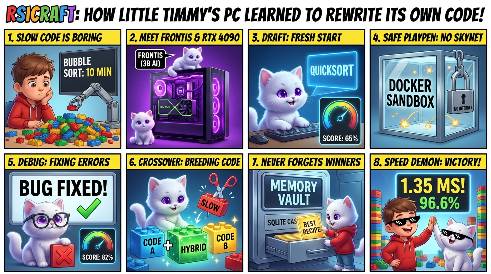

# RSICraft - 9-Tab Operator Manual, RSI Geopolitics & Tsinghua/OpenRSI Dossier

This manual mirrors the built-in `rsi_help` MCP tool (`rsicraft help-tabs --tab <slug> --search <query>`), the L3 `egui` Desktop Studio (`rsicraft-app`), and the interactive browser studio at [`docs/help/index.html`](docs/help/index.html).

```powershell
# View all 9 tabs in the terminal
rsicraft help-tabs

# View a single tab (overview | rsi_landscape | tsinghua_openrsi | wrappee | operators | compare | api | troubleshoot | faq)
rsicraft help-tabs --tab rsi_landscape
rsicraft help-tabs --tab tsinghua_openrsi

# Search across all tabs and sections
rsicraft help-tabs --search "Bowen Zhou"
```

---

## Visual Primer: Explain Like I'm 10 (8-Panel Cartoon)

<p align="center">
  
</p>

> *"Teaching a clever 10-year-old how RSICraft works on an RTX 4090 with Lego bricks, an AI kitten, an isolated Docker playpen, and genetic code breeding."*

📖 **Read the full illustrated story and YouTube short script:** **[`docs/LITTLE_TIMMY_EXPLAINS_RSI.md`](docs/LITTLE_TIMMY_EXPLAINS_RSI.md)**

* **Panel 1: The Lego Brick Crisis:** Timmy's 10-minute sorting script is too slow ($O(N^2)$ bubble sort).
* **Panel 2: Frontis on the RTX 4090:** A lightweight 3B MoE kitten running locally on Goliath at 120 tok/s.
* **Panel 3: Step 1 &mdash; `DRAFT`:** Frontis sketches a Quicksort baseline from scratch; score jumps to 65%.
* **Panel 4: The Docker Sandbox Playpen:** Unbreakable locked glass box with zero internet. Code cannot escape to steal cookies or become Skynet.
* **Panel 5: Step 2 &mdash; `DEBUG`:** Reading the compiler's red stack trace and patching off-by-one errors to reach 82%.
* **Panel 6: Steps 3 & 4 &mdash; `IMPROVE` & `CROSSOVER`:** Breeding the best parts of two programs and snipping slow `max()` calls.
* **Panel 7: The Stigmergic Memory Vault:** Storing winning recipes with BLAKE3 cryptographic fingerprints in SQLite WAL.
* **Panel 8: The 1.35ms Speed Demon:** 1,000,000 bricks sorted in 1.35 milliseconds! Pareto frontier victory (**96.6%**).

---

## Tab 1: Overview & 3-Crate Architecture (`overview`)

**RSICraft** is a pure-Rust Sovereign Recursive Self-Improvement (RSI) Studio, CLI & MCP Engine designed for consumer 24 GB GPUs (**Goliath**: AMD Ryzen 9 7900X, 64 GB DDR5, NVIDIA GeForce RTX 4090 24 GB VRAM).

1. **`rsicraft-core` (`L1 Core + Store`)**: Transactional SQLite `WAL` store (`tasks`, `experience_cards`, `task_frontiers`), 256-bit **BLAKE3** content-addressable hashing, **Zstd** (level 3) source code compression, 3-term composite utility parent selection, 4-operator evolutionary loop (`DRAFT`, `IMPROVE`, `DEBUG`, `CROSSOVER`), `llama-server` OpenAI-compatible inference client, and multi-backend sandbox runner (`docker`, `local`, `demo`).
2. **`rsicraft-mcp` (`L2 CLI + MCP Binary`)**: Single binary exposing 26 MCP tools over `stdio` (`2024-11-05`) and 1:1 CLI subcommands.
3. **`rsicraft-app` (`L3 Native GPU Desktop Studio`)**: High-contrast `slate-950` `eframe`/`egui 0.37` desktop workstation featuring a non-blocking background worker thread, **Live Run Control Panel**, interactive GPU-painted **Cubic Bézier Lineage DAG Canvas**, **Evolutionary Score Trajectory Spark Chart**, **4-Operator Launchpad**, **BLAKE3+Zstd CAS Inspector**, **RTX 4090 VRAM Gauge**, and **9-Tab Dossier**.

---

## Tab 2: What is RSI? The Western "Skynet" Myth & Closed Frontier Labs (`rsi_landscape`)

Full deep dive: **[`docs/RSI_LANDSCAPE_AND_SKYNET_MYTH.md`](docs/RSI_LANDSCAPE_AND_SKYNET_MYTH.md)**

- **What RSI Actually Is:** Recursive Self-Improvement is an execution-grounded evolutionary loop in which an agent proposes structured mutations to algorithms or ML pipelines, evaluates them inside a deterministic sandbox oracle, and selects parents for the next generation using objective fitness and novelty metrics.
- **Ominous Undertones in Western Politics ("Will It Be Skynet?"):** Since I.J. Good (1965) and Nick Bostrom (2014), Washington senate hearings, Executive Orders, and Brussels/California policy circles have framed RSI as an apocalyptic "intelligence explosion" or **Skynet** threshold-creating a regulatory narrative that self-improving code loops are too dangerous for open-weights academia or independent developers to possess.
- **OpenAI & Anthropic's Closed-Door RSI Experiments:**
  - **OpenAI Preparedness Framework:** Categorizes *"AI Self-Improvement"* (automated ML R&D) as a High/Critical risk track. OpenAI discusses internal `o1`/`o3`/`o4` self-play and automated researcher evaluations in system cards while keeping all operator policies and evolutionary harnesses 100% proprietary.
  - **Anthropic Responsible Scaling Policy (ASL-4):** Defines *"Autonomy & Automated AI R&D"* (Claude autonomously optimizing kernels and training pipelines) as the ASL-4 containment trigger, publishing high-level marketing charts while keeping the entire RSI loop locked behind closed APIs.

---

## Tab 3: The Total Expectation Flip: Tsinghua University & Frontis.AI (`tsinghua_openrsi`)

Full deep dive: **[`docs/TSINGHUA_OPENRSI_TEAM.md`](docs/TSINGHUA_OPENRSI_TEAM.md)**

On **July 30, 2026**, a 24-researcher team from **Tsinghua University**, **Frontis.AI**, and **Horizon Research** published [*Frontis-MA1: Training an AI4AI Model towards Recursive Self-Improvement in Machine Learning Engineering* (`arXiv:2607.28568`)](https://arxiv.org/abs/2607.28568) and open-sourced the complete stack at [`https://github.com/FrontisAI/OpenRSI`](https://github.com/FrontisAI/OpenRSI).

- **The Tsinghua University & Frontis.AI Team:**
  - **Principal Investigators:** **Prof. Bowen Zhou** (Chair Professor, Dept. of Electronic Engineering, Tsinghua University; Dean of Shanghai AI Lab; former Head of AI Foundations at IBM Research Watson & JD AI; co-author of the June 2026 survey *"Self-Improving Agents in the Era of Experience"*), **Dr. Ning Ding** (Tsinghua NLP / OpenBMB co-founder, creator of *UltraFeedback* & *MiniCPM*), and **Kaiyan Zhang** (Tsinghua University).
  - **24-Author Roster:** Junlin Yang, Che Jiang, Yu Fu, Tianwei Luo, Can Ren, Weizhi Wang, Kaikai Zhao, Hongyi Liu, Yuxin Zuo, Yuru Wang, Yuchen Fan, Kai Tian, Zhenzhao Yuan, Xiaojian Lin, Li Sheng, Rushi Qiang, Guoli Jia, Xingtai Lv, Ermo Hua, Dianqiao Lei, Youbang Sun, Ning Ding, Bowen Zhou, and Kaiyan Zhang.
- **Why It Flipped Every Expectation:**
  1. **Single RTX 4090 Budget:** Proved state-of-the-art evolutionary self-improvement on *MLE-Bench Lite* under a strict consumer hardware constraint (a single 24 GB NVIDIA RTX 4090 over a 12-hour budget).
  2. **The 3-Pillar OpenMLE Stack:** `OpenMLE-Gym` (verifiable sandboxed tasks), `OpenMLE-ERL` (execution-grounded SFT + RL around 4 atomic operators), and `OpenMLE-Evo` (composite-utility long-horizon search).
  3. **Pure-Rust Hardening (`RSICraft`):** `RSICraft` compiles Tsinghua & Frontis.AI's exact mathematical and operator blueprint into a zero-panic 3-crate Rust workspace.

---

## Tab 4: Wrapped Backends - RTX 4090 Inference & Sandboxes (`wrappee`)

- **Goliath RTX 4090 VRAM Allocation (`18.0–19.5 GB` / `24.0 GB`):** Runs `Frontis-MA1` 30B/35B MoE (`Q4_K_M` / `Q5_K_M`, ~3B active/token) with a `16,384` context window and `q4_0` KV cache quantization at ~120 tok/s, leaving `> 4.5 GB` free VRAM safety margin.
- **Automatic Reasoning-Tag Stripping (`operators.rs`):** Strips `<|channel>thought...<channel|>` and `<think>...</think>` blocks before extracting fenced Python modules.
- **Three Sandbox Modes (`sandbox.rs`):** `docker` (air-gapped rootless container `--network none --read-only`), `local` (isolated Python 3.12 tempdir with 50 ms timeout reaper), and `demo` (deterministic in-memory oracle).

---

## Tab 5: 4-Operator Action Space & Composite Utility Math (`operators`)

$$U_i = 0.50 \cdot s_{\text{norm}, i} + 0.35 \cdot \Delta_{\text{norm}, i} + 0.15 \cdot \frac{1}{1 + \text{children\_count}_i}$$

- **`DRAFT` (`T = 0.70`)**: Synthesizes a fresh baseline solution from the task description alone.
- **`IMPROVE` (`T = 0.40`)**: Samples one functional parent (`status == SUCCESS`) via stochastic roulette over $U_i$ and optimizes algorithmic or constant-factor bottlenecks.
- **`DEBUG` (`T = 0.20`)**: Samples one broken parent (`status != SUCCESS`) and injects its compiler/runtime stack trace (`raw_output`) to synthesize a targeted fix.
- **`CROSSOVER` (`T = 0.50`)**: Samples two distinct functional parents (`parent_a != parent_b`) and combines their best mechanisms into a single hybrid child.

---

## Tab 6: Competitive Architecture Matrix (`compare`)

| Feature / Metric | OpenAI / Anthropic RSI | DeepMind FunSearch | `FrontisAI/OpenRSI` (Python) | **RSICraft (`0.3.1` Rust)** |
| :--- | :--- | :--- | :--- | :--- |
| **Weights & Harness** | 100% Closed / Proprietary | Partial Python scripts | Open Weights + Python Stack | **Pure Rust 3-Crate + Native GPU Studio** |
| **Hardware Target** | Datacenter H100 clusters | Cloud TPUs / containers | Single RTX 4090 (Python) | **Single RTX 4090 (<15 ms Rust startup)** |
| **Artifact Storage** | Proprietary cloud | Raw strings | Files on disk | **SQLite `WAL` + BLAKE3 + Zstd L3 CAS** |
| **Parent Selection** | Undisclosed | Island Boltzmann score | $U_i$ Composite Utility | **$U_i = 0.50s + 0.35\Delta + 0.15\nu$ in SQLite** |
| **Frontis Ladder Coverage** | Closed Industrial R&D | Rung 1 (Heuristic Search) | Rung 1 (Search Prototype) | **Rung 1 running. Export, train script, and alias gate exist. Loop not closed.** |
| **Search Policy Engine** | Proprietary RL | Static Island Mutation | Fixed Operator Schedule | **Fixed 4-operator cycle. Bandit is advisory and unused.** |
| **Closed-Loop Model Update** | Closed Cloud Retraining | None (Frozen Weights) | Offline Research Scripts | **Not closed. Training does not change the active model.** |
| **Desktop Studio** | None | None | None | **Native `eframe`/`egui 0.37` Bézier DAG Studio** |
| **MCP Support** | None | None | None | **26 Stdio Tools (`2024-11-05`)** |

---

## Tab 7: 26 MCP Tools & CLI Reference (`api`)

See **[docs/TOOLS.md](docs/TOOLS.md)** for full JSON schemas and request/response payloads.

---

## Tab 8: Incident-Grounded Troubleshooting (`troubleshoot`)

See **[docs/TROUBLESHOOTING.md](docs/TROUBLESHOOTING.md)** for the full production runbook.

---

## Tab 9: FAQ & Safety Invariants (`faq`)

1. **Zero-Panic Rust:** `#![deny(clippy::unwrap_used, clippy::expect_used, clippy::panic, clippy::todo, clippy::unimplemented)]` enforced across all workspace crates.
2. **Air-Gapped Container Sandbox:** `--network none`, `--read-only`, `--cap-drop ALL`, `--pids-limit 64`, `--memory 4g`.
3. **Wall-Clock Timeout Reaper:** 50 ms polling loop terminates runaway candidates and logs `TIMEOUT`.
4. **Content-Addressable Integrity:** 256-bit BLAKE3 digest verification + Zstd level-3 compression in SQLite `WAL`.
5. **Tofu-Free GPU Studio & Pure Stdio MCP:** Zero unrenderable Unicode dingbats in `rsicraft-app` (`glyph_allowlist_no_tofu_chars`) and zero non-JSON bytes on `stdout` in `rsicraft mcp` mode.
