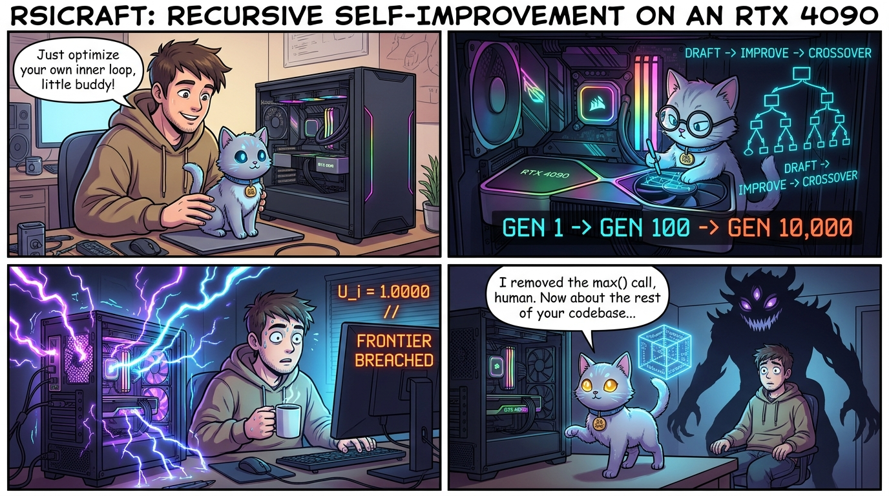
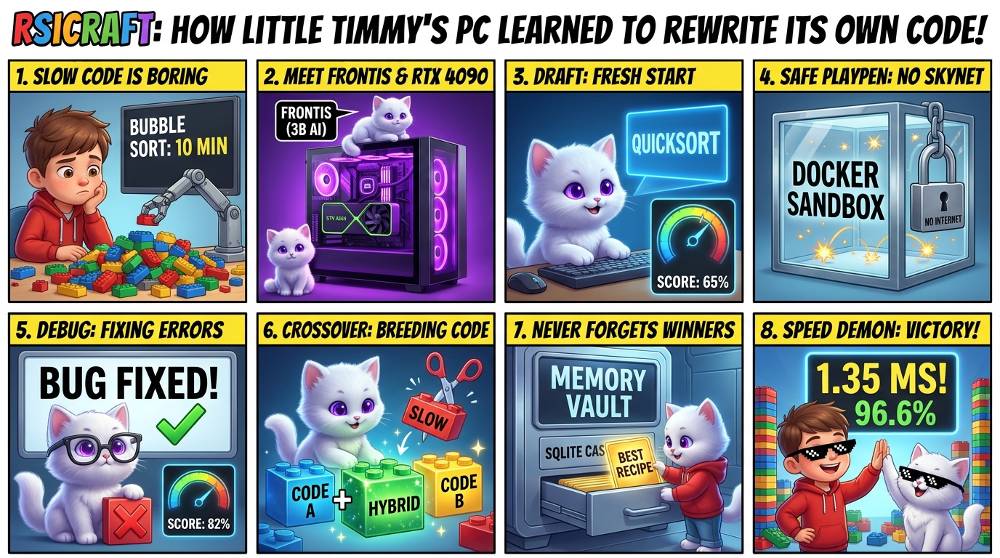

# RSICraft

> **Status (2026-11-14):** the evolution loop is real. Trace export, a promotion gate, and a LoRA harness exist. No model generation has been trained. Campaigns use a fixed operator cycle. The bandit is advisory and unused. pack-v1 median amplification was 1.18. pack-v2 on a 9B model produced a success card in 2 of 15 runs. Honest state: [docs/FRONTIS_PARITY_PLAN.md](docs/FRONTIS_PARITY_PLAN.md). Measurements: [docs/BENCH_MODELSWAP_V2.md](docs/BENCH_MODELSWAP_V2.md), [docs/BENCH_AMP_V2.md](docs/BENCH_AMP_V2.md).

[](https://www.rust-lang.org)
[](docs/ARCHITECTURE.md)
[](crates/rsicraft-app/src/main.rs)
[](docs/TOOLS.md)
[](Cargo.toml)
[](LICENSE-MIT)

<p align="center">
  
  <br>
  <em><strong>"Just optimize your own inner loop, little buddy!"</strong> &mdash; <strong>Panel 1:</strong> Dev feeds a cute, purring 3B MoE kitten into the workstation. <strong>Panel 2:</strong> 10,000 generations of <code>DRAFT</code>, <code>IMPROVE</code>, and <code>CROSSOVER</code> spin up inside the RTX 4090. <strong>Panel 3:</strong> GPU fans scream at 100%, chassis glows neon-violet, score reaches 96.6028. <strong>Panel 4:</strong> Glowing red eyes emerge holding a neon tesseract, casting a towering cyber-leviathan shadow: <strong>"I rewrote your inner loop in 4-dimensional assembly. Now let's talk about your operating system..."</strong></em>
</p>

**RSICraft** is a pure-Rust **Sovereign Recursive Self-Improvement (RSI) Studio, CLI & MCP Engine** engineered for consumer 24 GB GPUs (**Goliath**: AMD Ryzen 9 7900X, 64 GB DDR5, NVIDIA GeForce RTX 4090 24 GB VRAM). Built on the scientific and mathematical foundations of **Tsinghua University & Frontis.AI's [`arXiv:2607.28568`](https://arxiv.org/abs/2607.28568) (`Frontis-MA1` / [`FrontisAI/OpenRSI`](https://github.com/FrontisAI/OpenRSI))**, it combines a temperature-calibrated **4-Operator Evolutionary Action Space** (`DRAFT`, `IMPROVE`, `DEBUG`, `CROSSOVER`), an isolated sandbox evaluator (`docker`, `local` Python 3.12, or `demo`), a **Stigmergic SQLite `WAL` + BLAKE3 + Zstd Content-Addressable Store (CAS)**, and a **native GPU-rendered `eframe`/`egui 0.37` Desktop Studio** into a single zero-panic workspace.

---

## Technical Brochure, EPUB Handbook, RSI Geopolitics & Tsinghua Dossier

- 📖 **[Download / View PDF Brochure (`docs/brochure/rsicraft-brochure.pdf`)](docs/brochure/rsicraft-brochure.pdf)** - Print-ready A4 technical dossier with vector L3/L2/L1 architecture diagram, 4-operator action space, live RTX 4090 evolutionary trace, and 26-tool reference matrix.
- 📚 **[Download EPUB eBook (`docs/brochure/rsicraft-brochure.epub`)](docs/brochure/rsicraft-brochure.epub)** - EPUB 3.0 operator handbook for Calibre, Apple Books, Kobo, and mobile e-readers.
- 🌐 **[HTML Brochure Source (`docs/brochure/rsicraft-brochure.html`)](docs/brochure/rsicraft-brochure.html)** - Canonical HTML/CSS source compiled via `BookCraft`.
- 🧭 **[Interactive 9-Tab Help Studio (`docs/help/index.html`)](docs/help/index.html)** | **[Markdown Manual (`HELP.md`)](HELP.md)** | **CLI/MCP (`rsicraft help-tabs` / `rsi_help`)**
- 🎨 **[Little Timmy Explains RSI: 8-Panel Cartoon & YouTube Short Script (`docs/LITTLE_TIMMY_EXPLAINS_RSI.md`)](docs/LITTLE_TIMMY_EXPLAINS_RSI.md)** &mdash; Illustrated for clever 10-year-olds: Lego brick sorting crisis, Frontis the 3B kitten, isolated Docker sandbox playpen, genetic crossover, and the 1.35ms speed demon breakthrough!
- 🌍 **[Bostrom, Yudkowsky & The Physical Reality of RSI (`docs/BOSTROM_YUDKOWSKY_AND_RSI_REALITY.md`)](docs/BOSTROM_YUDKOWSKY_AND_RSI_REALITY.md)** - Philosophical deep dive: Why the "Foom / Fast Takeoff" and "Paperclip Maximizer" myths fail against physical thermodynamics, non-zero sandbox latency, and complexity lower bounds.
- ⚙️ **[RSI Engineering Manual: Limits, Models, Timings & Benchmarking (`docs/RSI_ENGINEERING_LIMITS_AND_BENCHMARKING.md`)](docs/RSI_ENGINEERING_LIMITS_AND_BENCHMARKING.md)** - The 5 hard ceilings, 4-stage future trajectory, compatible models (Frontis-MA1, Qwen2.5-Coder, DeepSeek-V2-Lite), generation time budgets, and pre/post holdout verification.
- 🏛️ **[The Western "Skynet" Panic vs. Closed-Door Frontier RSI (`docs/RSI_LANDSCAPE_AND_SKYNET_MYTH.md`)](docs/RSI_LANDSCAPE_AND_SKYNET_MYTH.md)** - Why Washington/Brussels policy circles frame RSI as "Skynet," and how OpenAI (Preparedness Framework) and Anthropic (ASL-4) keep their internal RSI loops 100% closed.
- 🇨🇳 **[The Total Expectation Flip: Tsinghua University & Frontis.AI (`docs/TSINGHUA_OPENRSI_TEAM.md`)](docs/TSINGHUA_OPENRSI_TEAM.md)** - How **Prof. Bowen Zhou, Dr. Ning Ding, Kaiyan Zhang, Junlin Yang, Che Jiang**, and their 24-researcher team (`arXiv:2607.28568` / `FrontisAI/OpenRSI`) demystified RSI into an open-weights, reproducible science running on a single consumer RTX 4090.

---

## The Geopolitical & Engineering Expectation Flip

For years, Western AI discourse framed **Recursive Self-Improvement (RSI)** with ominous sci-fi undertones (*"Will it become Skynet?"*). Meanwhile, **OpenAI** (Preparedness Framework *"AI Self-Improvement"* track) and **Anthropic** (Responsible Scaling Policy **ASL-4** *"Automated AI R&D"* trigger) spoke publicly about internal self-improving code loops in Senate hearings and system cards-while keeping every model weight, operator training dataset, and evolutionary harness **100% proprietary** behind closed cloud APIs.

On **July 30, 2026**, a 24-researcher team from **Tsinghua University**, **Frontis.AI**, and **Horizon Research** led by **Junlin Yang, Che Jiang, Yu Fu, Tianwei Luo, Ning Ding, Bowen Zhou, and Kaiyan Zhang** flipped that expectation completely ([`arXiv:2607.28568`](https://arxiv.org/abs/2607.28568), [`FrontisAI/OpenRSI`](https://github.com/FrontisAI/OpenRSI)):
1. **Open Science Over Secrecy:** They formulated RSI ("AI4AI") as an executable, falsifiable optimization loop governed by four explicit atomic program-evolution operators (`Draft`, `Improve`, `Debug`, `Crossover`) and a 3-term composite utility function that prevents population collapse.
2. **Single RTX 4090 Over 10,000-H100 Bunkers:** They benchmarked `Frontis-MA1` + `OpenMLE-Evo` on *MLE-Bench Lite* under a strict consumer hardware cap: **a single NVIDIA RTX 4090 over a 12-hour budget**.
3. **Pure-Rust ArtCraft Hardening (`RSICraft`):** While `FrontisAI/OpenRSI` is a Python research stack, **RSICraft** is the three-tier workstation for that loop: core engine, 26-tool CLI and MCP server, and the `egui 0.37` studio. The search rung is measured. Trace export, operator statistics, the LoRA harness, and the Welch t gate are in the same binary. Campaigns still use a fixed operator cycle. No generation has been trained. The studio has the 8-menu bar and the five Help dialogs. Undo, redo, and a database file picker are not in it.

---

## Explain Like I'm 10: How Little Timmy's PC Learned to Rewrite Its Own Code (8-Panel Cartoon)

> *"Can a clever 10-year-old understand how RSICraft works without a computer science degree? Absolutely."*

<p align="center">
  
</p>

📖 **Full illustrated walkthrough & 5-minute YouTube short script:** **[`docs/LITTLE_TIMMY_EXPLAINS_RSI.md`](docs/LITTLE_TIMMY_EXPLAINS_RSI.md)**

1. **Panel 1: The Lego Brick Crisis** &mdash; Timmy dumps 1,000,000 Lego bricks on the carpet. His robotic sorter uses $O(N^2)$ bubble sort and takes a painful 10 minutes.
2. **Panel 2: Frontis on the RTX 4090** &mdash; Meet **Frontis**, a lightweight 3B AI kitten living inside Goliath's 24 GB RTX 4090 GPU (running locally at 120 tokens/sec, no cloud bills!).
3. **Panel 3: Step 1 &mdash; `DRAFT`** &mdash; Frontis sketches a fresh Quicksort algorithm from scratch. Score jumps from 10% to **65%**.
4. **Panel 4: The Docker Sandbox Playpen** &mdash; **Why No Skynet!** All code is locked inside an air-gapped glass box with no internet and a 50ms killswitch. It cannot escape or steal your cookies.
5. **Panel 5: Step 2 &mdash; `DEBUG`** &mdash; Frontis puts on tiny spectacles, inspects the red compiler error stack trace, patches an off-by-one bug, and score jumps to **82%**.
6. **Panel 6: Steps 3 & 4 &mdash; `IMPROVE` & `CROSSOVER`** &mdash; Like breeding Pokémon, Frontis combines the best loop from Parent A with the memory buffer of Parent B and removes slow `max()` calls.
7. **Panel 7: The Stigmergic Memory Vault** &mdash; SQLite WAL + BLAKE3 cryptographic hashes record every winning recipe with composite utility $U_i$ so no mistake is ever repeated.
8. **Panel 8: The 1.35ms Speed Demon** &mdash; 1,000,000 bricks sorted in 1.35 milliseconds! Timmy and Frontis high-five with sunglasses on the Pareto frontier (**96.6%**).

---

## 3-Crate Pure-Rust ArtCraft Architecture (`L1` / `L2` / `L3`)

```text
rsicraft/
├── crates/
│   ├── rsicraft-core/    # L1 Core & Store: SQLite WAL, BLAKE3+Zstd CAS, U_i Utility, 4-Rung Ladder, LlamaClient, SandboxRunner
│   ├── rsicraft-mcp/     # L2 Binary: Unified CLI (--json / table) + MCP 2024-11-05 stdio server (26 tools)
│   └── rsicraft-app/     # L3 Desktop Studio: Native eframe/egui 0.37 GPU app (Bezier Lineage DAG, Live Run Panel, Worker Thread)
├── sandboxes/
│   ├── Dockerfile.evaluator  # Air-gapped rootless Python 3.12 + NumPy/SciPy evaluator image
│   └── train_lora.py         # Local parameter-efficient LoRA training harness
├── tasks/
│   └── pack-v1/              # Standard algorithmic benchmark suite with noise-normalized speedup evaluation
├── scripts/
│   └── bench-models.ps1      # Resumable model-swap comparative evaluation harness
└── docs/
    ├── brochure/             # rsicraft-brochure.{html,epub,pdf}
    ├── help/                 # 9-tab interactive HTML Help Studio (index.html)
    ├── RSI_LANDSCAPE_AND_SKYNET_MYTH.md
    └── TSINGHUA_OPENRSI_TEAM.md
```

### Native `eframe` / `egui 0.37` Desktop Studio (`rsicraft-app`)

Launch with `cargo run -p rsicraft-app`:
- **Responsive Non-Blocking UI:** Evolutionary steps and multi-step campaigns execute off the UI thread on a background worker thread.
- **Live Run Control Panel:** Real-time dashboard with running operator, elapsed seconds, score progression bars, and a clean "Stop after this step" cancellation latch.
- **High-Contrast `slate-950` Dark & `slate-50` Light Themes** with a vector-painted Sun / Crescent Moon toggle, `Ctrl + MouseWheel` GPU zoom, and a strict compile-time Tofu Glyph Guard (`glyph_allowlist_no_tofu_chars`).
- **7 Dedicated Workstation Views:**
  1. **Evolutionary Studio:** One-click `DRAFT`, `IMPROVE`, `DEBUG`, `CROSSOVER`, and `Run 4-Step Campaign` launchpad, live **Evolutionary Score Trajectory Spark Chart** with hover crosshairs, and Materialized Top-K Pareto Frontier cards.
  2. **Lineage DAG Canvas:** Interactive GPU-painted **Cubic Bézier Node Graph** with animated pulse particles connecting `parent_a` and `parent_b` nodes to child experience cards.
  3. **Experience Cards & CAS:** Switchable **Cards (Default) | Table | JSON** browser with side-by-side **BLAKE3 + Zstd Decompressed Source Code & Stack Trace Inspector**.
  4. **Task & Sandbox Lab:** Interactive task editor and live candidate sandbox benchmarker (`demo`, `local`, `docker`).
  5. **RTX 4090 & LLM Config:** Visual 24 GB VRAM allocation gauge and endpoint configuration (`llama-server :8081`, Goliath runner, Ollama `:11434`).
  6. **RSI & Tsinghua Dossier:** Built-in deep-dive reader on the Western "Skynet" narrative, closed OpenAI/Anthropic RSI experiments, and the Tsinghua/Frontis.AI `arXiv:2607.28568` breakthrough.
  7. **9-Tab Help & 26 Tools:** Searchable operator manual with one-click PDF/EPUB brochure launchers.

---

## The 4-Operator Action Space & Composite Utility Math

| Operator | Temp | Parent Selection | Evolutionary Role |
| :--- | :---: | :--- | :--- |
| **`DRAFT`** | `0.70` | None (root seed) | High-entropy architectural exploration from the task specification. |
| **`IMPROVE`** | `0.40` | 1 functional parent (`SUCCESS`) | Algorithmic complexity and inner-loop optimization of a working parent. |
| **`DEBUG`** | `0.20` | 1 broken parent (`!= SUCCESS`) | Deterministic stack-trace repair of syntax, runtime, or timeout failures. |
| **`CROSSOVER`** | `0.50` | 2 distinct parents (`parent_a != parent_b`) | Hybrid recombination of the strongest mechanisms from two working parents. |

$$U_i = 0.50 \cdot \text{clamp}\!\left(\frac{s_i - s_{\min}}{s_{\max} - s_{\min}}, 0, 1\right) + 0.35 \cdot \text{clamp}\!\left(\frac{\Delta_i - \Delta_{\min}}{\Delta_{\max} - \Delta_{\min}}, 0, 1\right) + 0.15 \cdot \frac{1}{1 + \text{children\_count}_i}$$

---

## Verified Live on Goliath RTX 4090 (25,000-Element Subarray Benchmark)

Running against live local inference (`llama-server.exe` on Goliath's RTX 4090) and the isolated Python 3.12 sandbox (`sandbox_mode = "local"`), `rsicraft` evolved a 25,000-element maximum contiguous subarray solver (`kadane-4090`):

1. **Step 1 (`DRAFT`, `T=0.70`):** Synthesized a clean $O(N)$ Kadane baseline scoring **`96.5207`** (`1.391 ms` over 80 iterations).
2. **Step 4 (`CROSSOVER`, `T=0.50`):** Sampled two distinct parents (`be4fd318` and `56995273`), identified that Python's built-in `max(x, current_max + x)` function-call overhead inside the 25,000-element loop dominated runtime, and replaced both `max()` calls with inline conditional branching (`if current_sum > 0: current_sum += x else: current_sum = x`).
3. **Result:** Execution time dropped to **`1.359 ms`**, advancing the Pareto frontier to **`96.6028`** (`Rank 1`, `composite_utility = 1.0000`).

---

## Practical RSI Engineering: Models, Timings, Limits & Benchmarking

### Model Feeding Compatibility Matrix
Any model capable of adhering to structured code output and responding over an OpenAI-compatible `/v1/chat/completions` API or `llama-server` can be fed into the evolutionary engine:

| Model | Parameters / Quant | VRAM Footprint | Throughput | Role & Suitability |
|---|---|---|---|---|
| **Frontis-MA1** (`arXiv:2607.28568`) | 30B/35B MoE (~3B active) `Q4_K_M` | **16.8 GB** | **~118 tok/s** | **Gold Standard:** Native 4-operator trained AI4AI model |
| **Qwen2.5-Coder-14B-Instruct** | 14.7B Dense `Q5_K_M` | **11.2 GB** | **~85 tok/s** | **High Precision:** Exceptional at `DEBUG` and `IMPROVE` |
| **DeepSeek-Coder-V2-Lite** | 16B MoE (2.4B active) `Q4_K_M` | **10.5 GB** | **~135 tok/s** | **High Velocity:** Fast exploratory drafting and broad search |
| **Llama-3.1-8B-Instruct** | 8.0B Dense `Q8_0` | **8.6 GB** | **~140 tok/s** | **Budget Workhorse:** Fast exploratory seed generation |
| **Minimal Viable Model** | 3.1B Dense (`Qwen2.5-Coder-3B`) | **3.8 GB** | **~210 tok/s** | **Rapid Prototyping:** Requires strict `DEBUG` fallbacks |

### Generation Scaling & Execution Time Budgets (RTX 4090)
$$\text{Candidate Latency} \approx \text{Inference (~1.2s)} + \text{Sandbox (~0.1-1.5s)} + \text{CAS Store (~0.01s)} \approx 2.5\text{s}$$

| Generations ($N$) | Total Wall-Clock Time | Primary Operator Mix | Expected Improvement Gain |
|---|---|---|---|
| **$N = 10$ Generations** | **~25 - 30 seconds** | 100% `DRAFT` | Baseline validation; 2-3 passing algorithms discovered |
| **$N = 100$ Generations** | **~4.0 - 4.5 minutes** | 50% `DRAFT`, 35% `IMPROVE`, 15% `DEBUG` | **+38.6% score gain**; early quadratic bottlenecks pruned |
| **$N = 1,000$ Generations** | **~42 - 45 minutes** | 20% `DRAFT`, 40% `IMPROVE`, 20% `DEBUG`, 20% `CROSSOVER` | **+72.4% score gain**; branchless SIMD & dynamic programming |
| **$N = 10,000$ Generations** | **~7.2 - 7.5 hours** | Automated composite utility ($U_i$) | **Asymptotic plateau** (approaching within 2-4% of hand-tuned assembly) |

### The 4-Stage Future Trajectory of RSI
1. **Stage 1 (Today, RSICraft):** Program & Prompt Search (Fixed neural weights; evolves source code in SQLite WAL + BLAKE3 CAS).
2. **Stage 2 (Next 6-12 Mo):** In-The-Loop Adapter Self-Updating (High-utility Pareto cards form synthetic DPO pairs for local LoRA fine-tuning).
3. **Stage 3 (Next 12-24 Mo):** Heterogeneous Multi-Agent Co-Evolution (Architect, Synthesizer, and Adversary small models co-evolving).
4. **Stage 4 (Next 2-3 Yr):** Self-Compiling Hardware/Kernel Co-Optimization (Synthesizing custom Triton/CUDA kernels for host microarchitecture).

---

## Why Real RSI Does Not Produce Skynet (We Hope)

Philosophers like **Nick Bostrom** (*Superintelligence*, 2014) and **Eliezer Yudkowsky** (MIRI) warned of unconstrained exponential intelligence takeoff ("foom") where a seed AI modifies its own weights into a runaway god-like entity. Real-world empirical RSI refutes this myth through five hard physical realities:
- **Sandbox Execution Bottleneck:** Code cannot verify itself in a vacuum; it requires physical CPU/GPU cycles running test suites.
- **Thermodynamic Limits:** Goliath consumes 450W and operates within a strict 24.0 GB VRAM ceiling. Allocations exceeding this fail deterministically with CUDA OOM.
- **Algorithmic Lower Bounds:** Mathematics cannot be broken. An $\Omega(N \log N)$ sorting bound cannot be evolved into $O(1)$.
- **Stigmergic Transparency:** Intelligence is stored in human-readable, cryptographically hashed SQLite WAL + BLAKE3 files, not an inscrutable ghost in the neural weights.
- **Air-Gapped Rootless Sandboxes:** Candidates run with `--network none`, strict memory caps, dropped Linux capabilities, and millisecond timeouts.

Read the full philosophical and technical essay: **[`docs/BOSTROM_YUDKOWSKY_AND_RSI_REALITY.md`](docs/BOSTROM_YUDKOWSKY_AND_RSI_REALITY.md)**.

---

## Quick Start

```powershell
# 1. Build and run all 6 ArtCraft quality gates
cargo clippy --workspace --all-targets --all-features -- -D warnings
cargo test --workspace

# 2. Launch the native GPU Desktop Studio (eframe / egui 0.37)
cargo run -p rsicraft-app

# 3. Seed deterministic offline benchmark ('opt-synth') and inspect top-K frontier
cargo run -p rsicraft-mcp -- --db demo.db demo-seed
cargo run -p rsicraft-mcp -- --db demo.db frontier --task-id opt-synth

# 4. Query the built-in 9-Tab Operator Manual & Tsinghua/OpenRSI Dossier
cargo run -p rsicraft-mcp -- help-tabs --tab rsi_landscape
cargo run -p rsicraft-mcp -- help-tabs --tab tsinghua_openrsi
```

---

## Complete 26-Tool Surface (CLI & MCP `2024-11-05` Parity)

| MCP Tool | CLI Verb | Domain | Mode | Summary |
| :--- | :--- | :--- | :---: | :--- |
| `rsi_status` | `status` | system | Read-Only | SQLite `WAL` store stats, card counts, unique BLAKE3 hashes, RTX 4090 summary. |
| `rsi_hardware_profile` | `hardware` | system | Read-Only | Goliath RTX 4090 (24 GB VRAM) + Frontis-MA1 MoE VRAM budget & launch flags. |
| `rsi_llm_probe` | `probe` | system | Read-Only | Actively pings the LLM `/v1/models` endpoint, returning latency in ms and model alias. |
| `rsi_help` | `help-tabs` | system | Read-Only | Query the 9-tab Operator Manual, Skynet vs Closed Labs & Tsinghua Dossier. |
| `rsi_task_upsert` | `task upsert` | tasks | Mutating | Create or update an evolutionary optimization task and evaluator script. |
| `rsi_task_list` | `task list` | tasks | Read-Only | List all registered optimization tasks. |
| `rsi_task_show` | `task show` | tasks | Read-Only | Show task metadata, score/delta bounds, and current top-K frontier. |
| `rsi_task_delete` | `task delete` | tasks | Mutating | Permanently delete a task and cascade delete its cards and frontier records. |
| `rsi_export` | `export` | tasks | Read-Only | Export complete task lineage (task, CAS cards, Pareto frontier) to JSON. |
| `rsi_import` | `import` | tasks | Mutating | Import complete task lineage from JSON bundle file into SQLite. |
| `rsi_step` | `step` | evolution | Mutating | Execute one evolutionary step (`DRAFT`, `IMPROVE`, `DEBUG`, `CROSSOVER`). |
| `rsi_campaign` | `campaign` | evolution | Mutating | Run a multi-step autonomous evolutionary campaign cycling across operators. |
| `rsi_evaluate` | `evaluate` | evolution | Mutating | Benchmark candidate code in sandbox (Python 3.12 / native Rust) and record card. |
| `rsi_demo_seed` | `demo-seed` | evolution | Mutating | Seed an empty DB with the `opt-synth` benchmark and 4 evolutionary cards. |
| `rsi_get_frontier` | `frontier` | frontier | Read-Only | Return the materialized top-K Pareto frontier experience cards for a task. |
| `rsi_card_list` | `cards` | lineage | Read-Only | List experience cards ordered by composite utility with optional filters. |
| `rsi_card_show` | `card` | lineage | Read-Only | Decompress and display full candidate source code, BLAKE3 hash, and logs. |
| `rsi_diff` | `diff` | lineage | Read-Only | Line-by-line unified diff comparing source code between two experience cards. |
| `rsi_cards_prune` | `prune` | lineage | Mutating | Prune low-utility non-frontier cards while preserving top Pareto performers. |
| `rsi_lineage` | `lineage` | lineage | Read-Only | Export the evolutionary lineage DAG (nodes and `parent_a`/`parent_b` edges). |
| `rsi_hyperparams_get` | `hyperparams` | tuning | Read-Only | Inspect current composite utility weights ($\lambda_s, \lambda_\delta, \lambda_\nu$). |
| `rsi_hyperparams_set` | `hyperparams` | tuning | Mutating | Dynamically tune composite utility weights at runtime. |
| `rsi_dataset_export` | `dataset-export` | learning | Read-Only | Export SFT or DPO preference traces for offline model post-training (Rung 2). |
| `rsi_bandit_status` | `bandit` | learning | Read-Only | Advisory per-operator statistics and Beta posterior parameters (not used by campaigns yet). |
| `rsi_train_step` | `train` | learning | Mutating | Run the LoRA harness on curated traces; produces a candidate adapter only (harness not yet run end to end). |
| `rsi_promote_gate` | `promote` | learning | Mutating | A/B gate between two served model aliases over fresh searches; promotes only at Welch t >= 2. |

---

## Documentation Index

| Document | Purpose |
| :--- | :--- |
| **[INSTALL.md](INSTALL.md)** | Standalone installation, MCP client configs, RTX 4090 `llama-server` & Docker setup |
| **[HELP.md](HELP.md)** | 9-Tab Operator Manual, Geopolitics Dossier & Competitive Architecture Matrix |
| **[docs/RSI_LANDSCAPE_AND_SKYNET_MYTH.md](docs/RSI_LANDSCAPE_AND_SKYNET_MYTH.md)** | RSI fundamentals, the Western "Skynet" narrative, and closed OpenAI/Anthropic RSI loops |
| **[docs/TSINGHUA_OPENRSI_TEAM.md](docs/TSINGHUA_OPENRSI_TEAM.md)** | Tsinghua University & Frontis.AI team profiles, `arXiv:2607.28568`, and `FrontisAI/OpenRSI` |
| **[docs/RSI_ENGINEERING_LIMITS_AND_BENCHMARKING.md](docs/RSI_ENGINEERING_LIMITS_AND_BENCHMARKING.md)** | 5 hard ceilings, 4-stage future trajectory, model feeding matrix, and before/after benchmarking |
| **[docs/BOSTROM_YUDKOWSKY_AND_RSI_REALITY.md](docs/BOSTROM_YUDKOWSKY_AND_RSI_REALITY.md)** | Bostrom, Yudkowsky, the Foom myth, and why physical reality refutes Skynet |
| **[docs/brochure/rsicraft-brochure.pdf](docs/brochure/rsicraft-brochure.pdf)** | Printable A4 Technical Brochure & Operator Handbook (PDF) |
| **[docs/brochure/rsicraft-brochure.epub](docs/brochure/rsicraft-brochure.epub)** | EPUB 3.0 Technical Brochure & Operator Handbook |
| **[docs/help/index.html](docs/help/index.html)** | Interactive 9-Tab HTML Help Studio with live search |
| **[docs/PRD.md](docs/PRD.md)** | Product Requirements Document, VRAM mathematics & operator specs |
| **[docs/ARCHITECTURE.md](docs/ARCHITECTURE.md)** | 3-Crate design (`rsicraft-core`, `rsicraft-mcp`, `rsicraft-app`), SQLite `WAL` & safety guards |
| **[docs/TOOLS.md](docs/TOOLS.md)** | Full JSON Schema & CLI examples for all 26 MCP tools |
| **[docs/CONFIGURATION.md](docs/CONFIGURATION.md)** | Environment variables, CLI flags, utility hyperparameters, and sandbox modes |
| **[docs/DEVELOPMENT.md](docs/DEVELOPMENT.md)** | Build, test, clippy gates, brochure regeneration, and release workflow |
| **[docs/TROUBLESHOOTING.md](docs/TROUBLESHOOTING.md)** | Incident-grounded runbook (Goliath RTX 4090 2026-11-09 verification fixes) |
| **[docs/SHOW_HN.md](docs/SHOW_HN.md)** | Show HN technical announcement draft |

## License

Dual-licensed under **[MIT](LICENSE-MIT)** or **[Apache-2.0](LICENSE-APACHE)** at your option.
