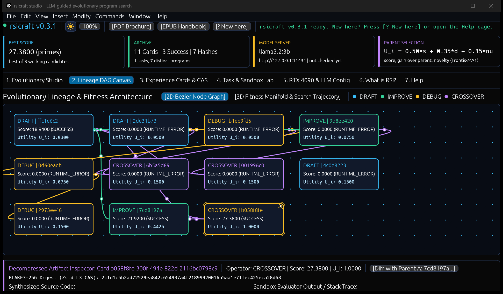
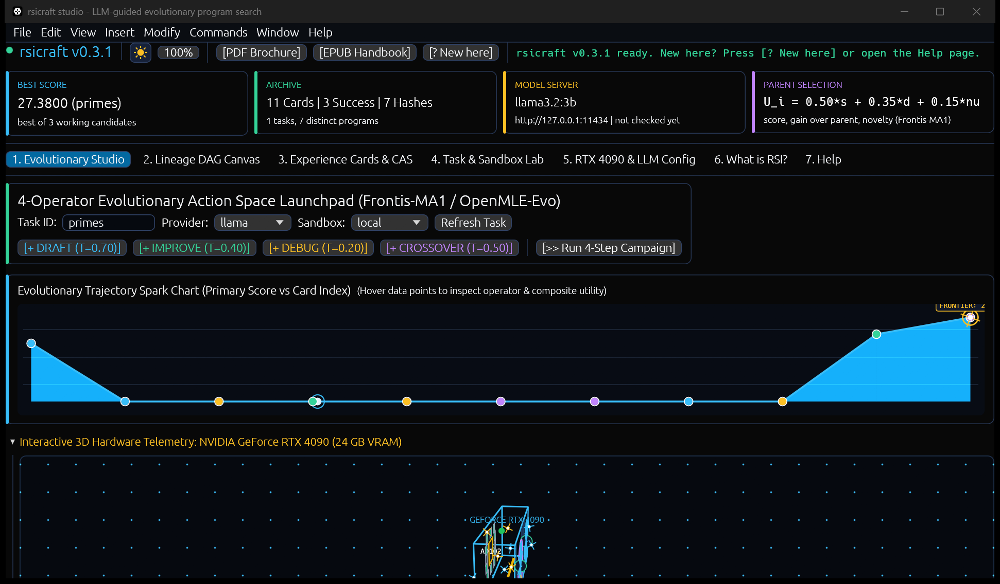
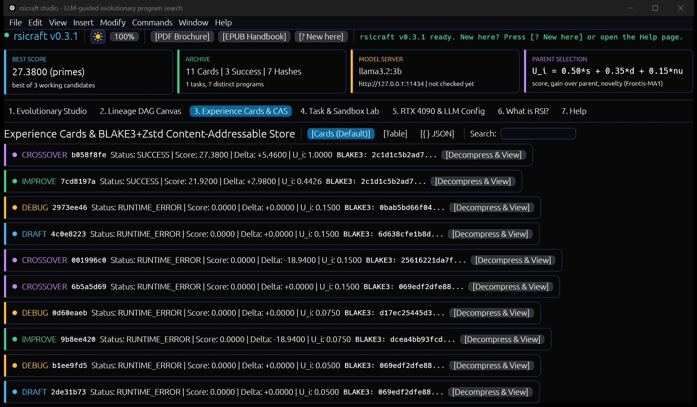
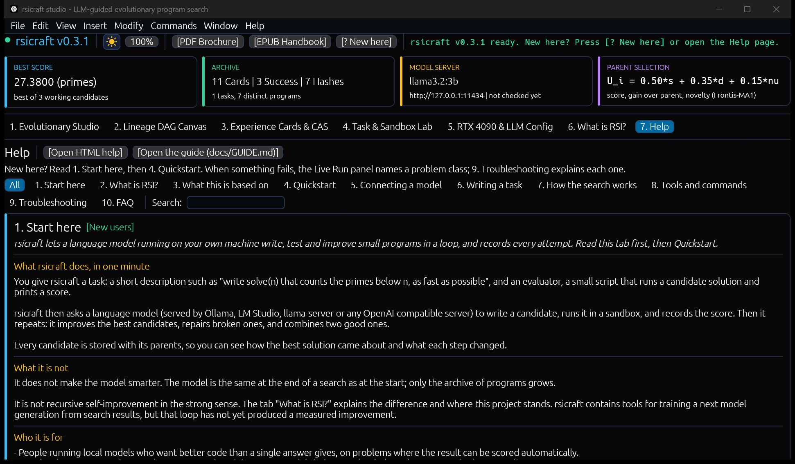

# rsicraft

**Goal: recursive self-improvement of a small language model, locally, on one RTX 4090.** rsicraft is a Rust reimplementation and test bench for the self-improvement ladder of **Frontis-MA1** ([arXiv:2607.28568](https://arxiv.org/abs/2607.28568), July 2026; Horizon Research, Frontis.AI and Tsinghua University; code at [FrontisAI/OpenRSI](https://github.com/FrontisAI/OpenRSI)). A local model searches for better programs; the records of that search are meant to train the next version of the model, which then searches again.

**Where it stands (2026-11-21): rung 1 works, rung 2 has not been run yet.** Details below, without spin.



## The ladder

The Frontis-MA1 paper describes three rungs. rsicraft follows the same ladder.

| Rung | What gets better | Status in rsicraft |
| :--- | :--- | :--- |
| 1. Evolution | The programs. A fixed model writes, tests, repairs and combines candidates with four operators (DRAFT, IMPROVE, DEBUG, CROSSOVER) and execution feedback. | **Works.** Verified with live local models (Ollama, LM Studio, llama-server), local and Docker sandboxes. |
| 2. Meta-evolution | The model. Successful search steps become training data; a LoRA adapter is trained on the small model; an A/B test promotes it only if it searches clearly better. | **Built, not yet run.** Trace export, `sandboxes/train_lora.py` and the promotion gate (Welch t of 2 or more) exist. No model generation has been trained. |
| 3. RSI | The process. Each promoted model produces the data for its successor, generation after generation. | **Not attempted.** No published system has shown this; the paper does not claim it either. |

Before training, rsicraft requires that search actually finds something the model did not produce on its first try: the **amplification gate**, median (best score / first working score) of 1.5 or more over 3 trials. Training on searches that add nothing would only teach the model its own first answers.

- pack-v1 (six textbook algorithm tasks, 35B models): median amplification 1.18. Gate not passed. Frontis-MA1-35B showed no advantage over its base model on these tasks ([report](docs/BENCH_MODELSWAP_V2.md)).
- pack-v2 (five heuristic tasks, `rsi-qwen9b`): the first run was invalid because of a code-extraction bug ([report](docs/BENCH_AMP_V2.md)). The bug is fixed; **a rerun is in progress**. If it passes the gate, the next step is the first LoRA generation of the 9B model and its promotion test.

The dated plan and every open item: [docs/FRONTIS_PARITY_PLAN.md](docs/FRONTIS_PARITY_PLAN.md).

## What the paper did, and what rsicraft takes from it

Frontis-MA1 trained the four operators (supervised fine-tuning, then reinforcement learning on executed results) and ran a long search harness that keeps experience cards and picks parents by score, gain and novelty. On MLE-Bench Lite, with 12 hours on one RTX 4090 per task, swapping the base model for Frontis-MA1-35B in the same harness raised the medal rate from 39.4% to 60.6%. The authors trained one generation, kept the search harness fixed, and state that they do not claim general recursive self-improvement.

rsicraft reimplements the ideas in Rust: the operator set and sampling temperatures (0.70 / 0.40 / 0.20 / 0.50), experience cards with lineage, parent selection by utility = 0.50 x score + 0.35 x gain + 0.15 x novelty, and model generations with a promotion test. It contains no OpenRSI code (that is CC BY-NC 4.0; rsicraft is MIT or Apache-2.0). Its own additions: one local binary with a desktop studio, CLI and MCP server, a SQLite archive, Docker isolation, classified model-server errors, and the benchmark tooling. Older roots of the approach: FunSearch (2023) and AlphaEvolve (2025) from Google DeepMind.

## The studio

| Evolutionary Studio | Experience cards |
| :---: | :---: |
| [](docs/screenshots/studio.png) | [](docs/screenshots/cards.png) |
| **Built-in help** | |
| [](docs/screenshots/help.png) | |

The screenshots show a real search, not demo data: 12 steps on the `primes` task with `llama3.2:3b` on Ollama in the local sandbox. A 3B model writes broken code often, which is why most cards are `RUNTIME_ERROR`; the search kept the three that worked and built on them. Regenerate with `scripts\capture-screenshots.ps1`.

## Install

There is no installer download yet; the v0.3.1 release contains only the PDF/EPUB brochure. From a checkout on Windows:

```powershell
cargo build --release
powershell -NoProfile -ExecutionPolicy Bypass -File scripts\install-craft.ps1
```

That installs the studio and the CLI (Start Menu shortcut, CLI on the user PATH). `-RegisterClients` also registers the MCP server with the IDEs that are installed (`-Clients cursor,claude-desktop` limits the list), and `-Mcpb` installs the Claude Desktop extension bundle. Manual MCP setup: [INSTALL.md](INSTALL.md).

## Quickstart

```powershell
# 1. Try it without a model (the demo provider invents scores)
rsicraft --db demo.db demo-seed
rsicraft --db demo.db campaign --task-id opt-synth --steps 4 --provider demo --sandbox-mode demo

# 2. Connect a local model and check it; it must say OK
$env:RSICRAFT_LLM_URL = 'http://127.0.0.1:11434'   # Ollama; LM Studio is :1234
$env:RSICRAFT_MODEL   = 'qwen2.5-coder:7b'
rsicraft probe

# 3. A real search
rsicraft task upsert --task-id primes --name "Prime count" `
  --description "Write solve(n) returning the number of primes below n, as fast as possible. Standard library only." `
  --evaluator-file tasks\pack-v1\primes.py
rsicraft campaign --task-id primes --steps 8 --provider llama --sandbox-mode local
rsicraft frontier --task-id primes

# 4. Watch it in the studio
rsicraft-app --task primes --page lineage
```

The local sandbox runs model-written code as you. For anything you would not run yourself, build `sandboxes/Dockerfile.evaluator` and use `--sandbox-mode docker` (no network, read-only, no privileges, memory and CPU limits).

## When the model server fails

Every failure is reported, never swallowed: `[llm:<class>] what happened | fix: what to do`. Campaigns check the server and model first and stop at once on setup problems (unreachable, unknown model, missing key, bad address); per-step problems (budget exhausted, no code, timeout, context overflow) are recorded with their class. `rsicraft probe` lists the models a server offers, warns when the context window is too small, and finds Ollama or LM Studio on the usual ports when nothing answers at the configured address. All twelve classes and their fixes: [Troubleshooting](docs/GUIDE.md#9-troubleshooting).

## Three ways to use it

| | Start with | For |
| :--- | :--- | :--- |
| Desktop studio | `rsicraft-app` | Watching runs, the lineage graph, code and diffs of every candidate |
| Command line | `rsicraft --help`, `rsicraft help-tabs` | Scripts and benchmarks; every verb accepts `--json` |
| MCP server | `rsicraft mcp` | Letting Claude or another agent drive searches and the training steps |

All three share one engine and one SQLite database (`%LOCALAPPDATA%\rsicraft\rsicraft.db`, or `--db` / `RSICRAFT_DB`).

## Documentation

| Document | Contents |
| :--- | :--- |
| [docs/GUIDE.md](docs/GUIDE.md) | The manual: what RSI is, what this is based on, quickstart, connecting a model, writing tasks, every error. Same text as the studio Help page and `rsicraft help-tabs` |
| [docs/FRONTIS_PARITY_PLAN.md](docs/FRONTIS_PARITY_PLAN.md) | Ladder status, plan and gates |
| [docs/BENCH_MODELSWAP_V2.md](docs/BENCH_MODELSWAP_V2.md), [docs/BENCH_AMP_V2.md](docs/BENCH_AMP_V2.md) | Benchmark reports |
| [INSTALL.md](INSTALL.md), [docs/CONFIGURATION.md](docs/CONFIGURATION.md), [docs/TROUBLESHOOTING.md](docs/TROUBLESHOOTING.md) | Setup, settings, incidents |
| [docs/PRD.md](docs/PRD.md), [docs/ARCHITECTURE.md](docs/ARCHITECTURE.md), [docs/DEVELOPMENT.md](docs/DEVELOPMENT.md), [docs/TOOLS.md](docs/TOOLS.md) | Requirements, design, build, MCP tool schemas |

Opinion and outreach pieces, not documentation (some numbers in them are illustrative): [docs/BOSTROM_YUDKOWSKY_AND_RSI_REALITY.md](docs/BOSTROM_YUDKOWSKY_AND_RSI_REALITY.md), [docs/TSINGHUA_OPENRSI_TEAM.md](docs/TSINGHUA_OPENRSI_TEAM.md), [docs/LITTLE_TIMMY_EXPLAINS_RSI.md](docs/LITTLE_TIMMY_EXPLAINS_RSI.md), [docs/brochure/](docs/brochure/).

## License

MIT or Apache-2.0, at your option. The Frontis-MA1 weights, if you use them, are under their own CC BY-NC 4.0 licence.
