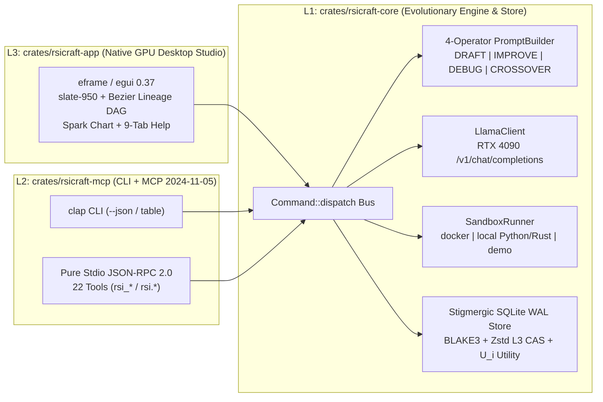

# Architecture & Safety Invariants: RSICraft

**Navigation:** [README](../README.md) · [PRD](PRD.md) · [RSI & The "Skynet" Myth](RSI_LANDSCAPE_AND_SKYNET_MYTH.md) · [Tsinghua & OpenRSI Dossier](TSINGHUA_OPENRSI_TEAM.md) · [Tools](TOOLS.md)

---

## 1. 3-Crate Pure-Rust ArtCraft Workspace (`L1` / `L2` / `L3`)

---

## 2. Database Schema (`schema.sql`) & BLAKE3 + Zstd CAS

`rsicraft-core::store` initializes an embedded SQLite database with `PRAGMA journal_mode = WAL`, `PRAGMA synchronous = NORMAL`, and `PRAGMA foreign_keys = ON`:

1. **`tasks`**: Stores `task_id`, `name`, `description`, `evaluator_script`, and `created_at`.
2. **`experience_cards`**: Stores every evolutionary candidate node:
   - Lineage edges: `parent_a_id`, `parent_b_id`, `operator_used` (`DRAFT`, `IMPROVE`, `DEBUG`, `CROSSOVER`).
   - Content-Addressable Storage (`cas.rs`): `code_hash` (64-char hex **BLAKE3** digest) and `compressed_code` (**Zstd** level-3 compressed binary payload).
   - Execution telemetry: `execution_status` (`SUCCESS`, `COMPILE_ERROR`, `RUNTIME_ERROR`, `TIMEOUT`, `METRIC_PARSE_ERROR`), `raw_output`, `execution_time_ms`.
   - Evolutionary fitness: `primary_score`, `delta_score`, `novelty_score` ($\nu_i = \frac{1}{1+\text{children\_count}_i}$), `composite_utility` ($U_i$), and `children_count`.
3. **`task_frontiers`**: Materialized top-K ranking per task (`task_id`, `card_id`, `rank`), atomically refreshed after every new card insertion.

---

## 3. Five Defense-in-Depth Safety Invariants

1. **Compile-Time Zero-Panic Guarantee:**
   Every crate in the workspace enforces `#![deny(clippy::unwrap_used, clippy::expect_used, clippy::panic, clippy::todo, clippy::unimplemented)]`.
2. **Air-Gapped Rootless Container Sandbox (`sandboxes/Dockerfile.evaluator`):**
   When `sandbox_mode = "docker"`, candidate code runs inside an unprivileged container with `--network none`, `--read-only`, `--cap-drop ALL`, `--security-opt no-new-privileges`, `--pids-limit 64`, `--memory 4g`, and `--cpus 4.0`.
3. **50 ms Polling Wall-Clock Timeout Reaper:**
   Both `docker` and `local` (Python 3.12 & native Rust `rustc`) evaluators poll child processes on a 50 ms interval and kill any runaway loop exceeding `timeout_secs`.
4. **Reasoning-Model Output Sanitization:**
   `PromptBuilder::extract_code_block` strips chain-of-thought blocks (`<|channel>thought...<channel|>`, `<think>...</think>`) before extracting the fenced Python module.
5. **Tofu-Free GPU Desktop Rendering (`glyph_allowlist_no_tofu_chars`):**
   `rsicraft-app` paints all status dots, theme icons, and Bézier lineage graphs with `ui.painter()` vector primitives and locks source code against unrenderable Unicode dingbats via an automated unit test.
