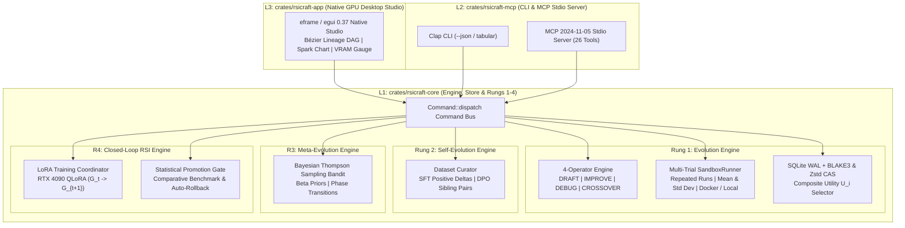

# Architecture and Systems Design: RSICraft

**Navigation:** [README](../README.md) · [Product Requirements (PRD)](PRD.md) · [Philosophical Foundations](BOSTROM_YUDKOWSKY_AND_RSI_REALITY.md) · [Tools Reference](TOOLS.md) · [9-Tab Help](../HELP.md)

---

## 1. The 3-Crate Pure-Rust ArtCraft Architecture

RSICraft is architected as an ArtCraft-compliant three-crate Rust workspace enforcing `#![deny(clippy::unwrap_used, clippy::expect_used, clippy::panic, clippy::todo, clippy::unimplemented)]` across all production binaries:



---

## 2. Core Functional Subsystems

### 2.1 Multi-Trial Sandbox Runner (`crates/rsicraft-core/src/sandbox.rs`)
To prevent the evolutionary search loop from selecting measurement noise or transient scheduler fluctuations:
- **Execution Gateway:** The unified `evaluate` entry point accepts candidate source code, task evaluator scripts, and a trial parameter (`trials: u32`, default 1).
- **Single Compilation, Multi-Trial Run:** In native Rust sandbox mode, candidate code and evaluator harness compile once into a temporary binary (`rustc --crate-type=bin`), which is then executed $N$ times.
- **Statistical Metric Extraction:** Computes sample mean ($\bar{s}$), sample standard deviation ($s$), and logs `runs_count` directly into the database card telemetry.
- **Air-Gapped Docker Mode:** Evaluates Python candidates inside rootless containers (`sandboxes/Dockerfile.evaluator`) with `--network none`, `--read-only`, `--cap-drop ALL`, `--user 10000:10001`, and a 50 ms polling watchdog reaper.

### 2.2 Content-Addressable Storage and Utility Selector (`store/`)
- **Stigmergic Persistence:** SQLite WAL engine (`schema.sql`) maintains relational tables for `tasks`, `experience_cards`, and materialized `task_frontiers`.
- **Deduplication and Compression:** Candidate source strings are digested via 256-bit **BLAKE3** cryptographic hashing and compressed with **Zstd (level 3)** binary payloads, preventing storage bloat over millions of iterations.
- **Composite Utility ($U_i$):**
  $$U_i = 0.50 \cdot \tilde{s}_i + 0.35 \cdot \tilde{\Delta}_i + 0.15 \cdot \frac{1}{1 + \text{children}_i}$$
  Normalization bounds are calculated strictly over `SUCCESS` nodes to prevent failed cards from flattening selection pressure.

### 2.3 Dataset Curation Engine (`store/dataset.rs`)
- **SFT Trajectory Mining:** Identifies positive evolutionary leaps ($\Delta_i \ge \Delta_{\min}$) and successful `DEBUG` repairs from compiler/runtime errors, packaging them into standardized prompt-completion records.
- **Contrastive DPO Pairs:** Finds sibling branches descending from a common parent node, pairing superior performers with inferior or failed siblings for offline preference alignment.

### 2.4 Meta-Evolutionary Bandit Engine (`bandit.rs`)
- **Bayesian Thompson Sampling:** Models operator selection via Beta conjugate priors $\text{Beta}(\alpha_k, \beta_k)$ across the four action arms (`Draft`, `Improve`, `Debug`, `Crossover`).
- **Dynamic Phase Shifting:**
  - `Bootstrapping`: Forces initial diversity when card count $N < 5$.
  - `ErrorRecovery`: Shifts allocation toward deterministic `DEBUG` repair when sandbox error rates exceed 60%.
  - `AdaptiveBayesian`: Samples posterior distributions to automatically balance exploitation of winning operators against exploration of stalled branches.

### 2.5 Closed-Loop Model Generation and Promotion Gate (`trainer.rs` & `lib.rs`)
- **RTX 4090 LoRA Harness:** Orchestrates consumer GPU fine-tuning (`sandboxes/train_lora.py`) utilizing 4-bit NormalFloat base quantization and rank 16 low-rank adapters. Produces candidate adapters without modifying the active generation until passing the promotion gate.
- **Model Lineage:** Tracks generation transitions ($G_0 \to G_1 \to \dots \to G_t$), updating the task's promoted model alias in SQLite WAL.
- **Welch's $t$-Test Promotion Gate:** Benchmarks candidate generation $G_{t+1}$ against baseline $G_t$ over $K$ repeated evaluation trials (interleaved to cancel host-side performance drift). If Welch's $t \ge 2.0$, the candidate is promoted; otherwise, rollback is preserved.

### 2.6 The 3-Phase Step Pipeline (`plan_step` / `run_step` / `commit_step`)
To prevent multi-minute LLM completions or sandbox runs from holding SQLite database locks:
- **`plan_step` / `plan_evaluate`:** Reads current task frontiers, samples parent candidates, and builds operator prompts in a brief read-only transaction.
- **`run_step` / `run_evaluate`:** Executes inference against `llama-server` or Ollama and compiles/runs sandbox evaluation completely off the database lock. Handles reasoning models gracefully with a 12,288-token budget, thought-preamble code extraction, and list-nested fence dedenting.
- **`commit_step` / `commit_evaluate`:** Acquires an exclusive lock only to store the resulting BLAKE3/Zstd experience card, recompute task utility scores, and update the materialized Pareto frontier.

### 2.7 Desktop Studio Worker Thread & Live Run Panel (`rsicraft-app`)
- **Non-Blocking Architecture:** Evolutionary campaigns and lab evaluations run on a dedicated worker thread communicating via thread-safe channels, keeping the `egui` UI thread rendering at a solid 60 FPS.
- **Live Run Panel:** Real-time dashboard showing active operator, elapsed seconds, progress bars, per-step score delta markers, and a responsive "Stop after this step" cancellation latch.

---

## 3. Defense-in-Depth Safety Invariants

```
+---------------------------------------------------------------------------------------------------+
|                                  THE 5 PRODUCTION SAFETY INVARIANTS                               |
+---------------------------------------------------------------------------------------------------+
| 1. ZERO-PANIC COMPILATION        | Denies unwrap, expect, panic, todo, and unimplemented at build.|
| 2. AIR-GAPPED CONTAINER SANDBOX  | --network none, --read-only, --cap-drop ALL, unprivileged UID. |
| 3. WALL-CLOCK WATCHDOG REAPER    | 50 ms polling loop terminates runaway processes deterministically.|
| 4. METRIC BOUNDARY INTEGRITY     | Evaluator stdout parsed with strict JSON delimiter validation.  |
| 5. GLYPH ALLOWLIST TOFU GUARD    | Automated GPU rendering checks reject unrenderable characters. |
+---------------------------------------------------------------------------------------------------+
```

1. **Compile-Time Zero-Panic Guarantee:**
   Every workspace crate denies all forms of unhandled panics (`#![deny(clippy::unwrap_used, clippy::expect_used, clippy::panic, clippy::todo, clippy::unimplemented)]`). All error propagation traverses explicit `Result<T, RsiError>` types.
2. **Air-Gapped Rootless Sandbox:**
   In Docker mode, code execution runs with dropped capabilities, disabled network stacks, read-only root filesystems, and strict memory and PID ceilings.
3. **Host-Side Watchdog:**
   A polling reaper tracks process lifetime on the host side, eliminating child zombies and halting execution when wall-clock deadlines expire.
4. **Metric Boundary Integrity:**
   The evaluation metric `RSI_METRIC_JSON=` is parsed strictly from the final emitted stdout marker, protecting against candidate interference.
5. **GPU Render Safety:**
   `rsicraft-app` tests prevent UI lockups or unrenderable Unicode glyphs across all desktop studio panes.
