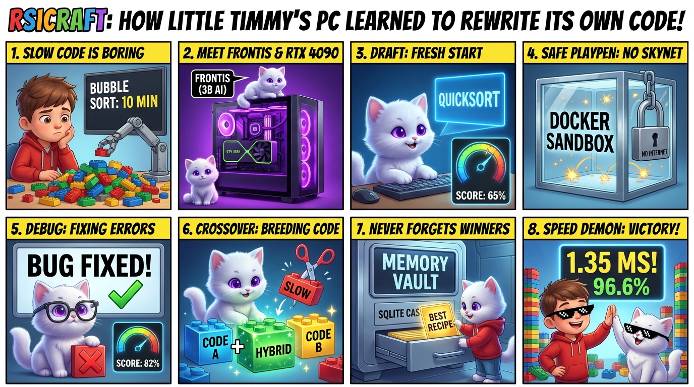

# RSICraft for Clever 10-Year-Olds: How Little Timmy's PC Learned to Rewrite Its Own Code!

> *"You don't need a bunker with ten thousand supercomputers to do Recursive Self-Improvement. You just need a clever loop, a safe playpen, and a fast GPU."*

  
   
  <em><strong>Figure 1:</strong> The 8-Panel Cartoon Explainer &mdash; How Little Timmy and Frontis the AI Kitten taught their PC to rewrite its own code in 8 simple steps.</em>

---

## The Story: Little Timmy and the 10-Minute Lego Disaster

Little Timmy is 10 years old. He has two favorite things in the whole world:
1. Building giant Lego rollercoasters.
2. Writing Python scripts to control a robotic sorter arm that organizes his bricks by color and size.

One Saturday morning, Timmy dumped a giant bucket of **1,000,000 Lego bricks** onto the carpet. He plugged in his robotic arm, loaded his Python script, pressed `Enter`... and waited.

And waited.

And waited!

His script used something called **Bubble Sort** ($O(N^2)$). It compared every single brick against every other brick. The computer's fan whirred like a jet engine, and the screen estimated: **"Sorting complete in: 10 minutes and 42 seconds."**

*"Ten minutes?!"* Timmy shouted. *"My cartoon will be over before my robot even sorts the red bricks!"*

Sitting on top of Timmy's PC case was **Frontis**, a fluffy little kitten with glowing violet eyes. Frontis wasn't an ordinary cat-she was a **3B Mixture-of-Experts (MoE) AI** running directly on **Goliath**, Timmy's local NVIDIA GeForce RTX 4090 desktop.

*"Purr..."* Frontis meowed. *"Timmy, don't just sit there waiting. Why don't we turn on **RSICraft** and let me rewrite your sorting code myself?"*

Here is exactly what happened next, in **8 easy panels**!

---

## The 8-Panel Comic Breakdown

### 🧱 Panel 1: The Lego Brick Crisis (Slow Code is Boring!)
* **What happens:** Timmy stares in despair at a massive pile of a million unsorted Lego bricks. A sluggish robot arm picks up one brick every ten seconds, and the terminal displays a painful `ETA: 10m 42s`.
* **The Lesson:** Slow code makes everyone sad. Computers are fast, but bad algorithms make them crawl like snails.

### 🐱 Panel 2: Meet Frontis the 3B MoE Kitten on the RTX 4090
* **What happens:** Timmy introduces his secret weapon: **Goliath**, a desktop workstation with a 24 GB NVIDIA GeForce RTX 4090 graphics card, and **Frontis**, a lightweight 3-billion-parameter coding model based on Tsinghua University & Frontis.AI's research (`arXiv:2607.28568`).
* **The Lesson:** You don't need a giant corporate cloud with 10,000 servers. A single modern GPU on your desk can run thousands of code experiments right in your bedroom.

### ✍️ Panel 3: Step 1 &mdash; DRAFT (First Attempt)
* **What happens:** Frontis sits at the keyboard and executes operator #1: **`DRAFT`**. She writes a brand new sorting program from scratch using QuickSort. The computer runs it: the score jumps from 10% to **65%**!
* **The Lesson:** `DRAFT` is like sketching a fresh drawing on a blank piece of paper. It might not be perfect, but it gets the journey started.

### 🛡️ Panel 4: The Docker Sandbox Playpen (Why There is No Skynet!)
* **What happens:** Timmy locks the newly drafted code inside a transparent glass box labeled **Docker Sandbox Playpen**. Inside the box, a silly bug makes the robot arm fling Lego bricks in circles, but the glass contains everything. The box has **no internet connection** and cannot touch Timmy's files or steal his cookies.
* **The Lesson:** People worry: *"If AI rewrites its own code, will it turn into an evil robot (Skynet) and take over the world?"* **Nope!** In RSICraft, code is strictly locked inside an isolated sandbox. If it misbehaves, the sandbox instantly stops it in 50 milliseconds. It can never escape to the real world!

### 🔍 Panel 5: Step 2 &mdash; DEBUG (Reading the Red Errors)
* **What happens:** Frontis puts on tiny spectacles, reads the red compiler error message from the sandbox, and executes operator #2: **`DEBUG`**. She patches an off-by-one array index error. The score jumps from 65% to **82%**!
* **The Lesson:** When your code breaks, don't throw it away! `DEBUG` reads the exact error and fixes only the broken line.

### 🧬 Panel 6: Steps 3 & 4 &mdash; IMPROVE & CROSSOVER (Breeding Fast Code like Pokémon!)
* **What happens:** Frontis takes two different working programs that scored well (Parent A and Parent B) and uses operator #4: **`CROSSOVER`**. She snaps the best loop from Parent A into the smart memory buffer of Parent B, then applies operator #3: **`IMPROVE`** to remove a slow `max()` function call.
* **The Lesson:** Just like breeding strong Pokémon or combining cool Lego sets, `CROSSOVER` merges the superpowers of two working programs to create an even faster mutant child!

### 🏛️ Panel 7: The Stigmergic Memory Vault (Never Forgetting What Worked)
* **What happens:** Timmy opens the computer's secret vault: a high-speed SQLite database with **BLAKE3 digital fingerprints** and **Zstd compression**. Every winning piece of code is saved forever with a mathematical score called **Composite Utility** ($U_i$).
* **The Lesson:** "Stigmergy" is a fancy word for leaving notes so you never repeat the same mistake. Ants do it with scents, and RSICraft does it with cryptographic hashes.

### ⚡ Panel 8: The 1.35-Millisecond Speed Demon (Victory!)
* **What happens:** Timmy and Frontis put on cool sunglasses. The final evolved code runs on the robotic arm: *BZZZZT!* In **1.35 milliseconds**, all 1,000,000 Lego bricks are sorted into neat, perfect towers! The score reaches a stellar **96.6%** on the Pareto Frontier.
* **The Lesson:** Through evolutionary self-improvement, the computer didn't just run code-it made its own code **400,000 times faster**!

---

## 🎬 5-Minute YouTube Short / Explainer Script

*Ready for voiceover, sound effects, animations, and video production for YouTube and TikTok.*

| Timestamp | Visual Cue | Audio / Voiceover Line | SFX & Music |
| :--- | :--- | :--- | :--- |
| **0:00 - 0:30** | Little Timmy tapping his foot while a spinning loading wheel says *"Sorting 1,000,000 bricks... 10 min remaining"*. Timmy facepalms. | *"Have you ever written a piece of computer code that was so painfully slow you had time to bake cookies while waiting for it to finish? Meet Little Timmy. His Lego sorting robot is taking 10 whole minutes to sort a pile of plastic bricks. But Timmy has an idea: what if his computer could rewrite its own brain to go faster?"* | Cartoon sad trombone, ticking clock sound. Upbeat chiptune music kicks in. |
| **0:30 - 1:15** | Camera zooms into Timmy's desk. Glowing purple neon PC case with an RTX 4090 GPU inside. A cartoon kitten with glowing purple eyes pops up on the keyboard. | *"This is Goliath, Timmy's desktop PC with an NVIDIA RTX 4090. And this little fella is Frontis-a tiny 3-billion-parameter AI model trained on research from Tsinghua University. Unlike big corporate AI that costs millions in server bills, Frontis lives right on Timmy's desk. And she has one job: Recursive Self-Improvement, or RSI!"* | Futuristic power-up hum, cute cat purr, GPU fans spooling up. |
| **1:15 - 2:00** | Frontis types on the keyboard. A glowing blue blueprint appears: `DRAFT` operator. Score card flips from `10%` to `65%`. | *"Step 1 is DRAFT. Frontis doesn't mess around with bubble sort. She writes a fresh Quicksort algorithm from scratch! Boom: the score immediately jumps to 65%. But wait-does it work? Or will it crash the computer?"* | Mechanical keyboard clatter, cash register *ding!* |
| **2:00 - 2:45** | Code gets dropped into a thick glass cube with steel padlocks labeled `Docker Sandbox: No Internet`. Code throws a red error sparks inside the cube, but the outside stays safe. | *"This is where most people get scared: 'Wait, if the AI is writing code, won't it turn into an evil robot and take over the world?' NOPE! In RSICraft, every line of new code is locked inside a sealed Docker sandbox playpen. No internet, no file access, and a 50-millisecond killswitch. If a program throws sparks, it stays inside the box!"* | Glass clinking, heavy steel door slamming shut, electric zap. |
| **2:45 - 3:30** | Frontis puts on detective glasses. A red error line `IndexError: list index out of range` appears. Frontis swaps it with green code: `DEBUG` operator. Score jumps to `82%`. | *"When code throws an error, Frontis doesn't cry. She triggers operator #2: DEBUG! She reads the compiler's red stack trace, patches the exact off-by-one bug, and pushes the score up to 82%!"* | Magnifying glass whoosh, pencil scribble, triumphant video game chime. |
| **3:30 - 4:15** | Two puzzle pieces (Parent A and Parent B) merge into a shiny glowing hybrid piece: `CROSSOVER` and `IMPROVE`. Frontis deletes an expensive `max()` call. | *"Now comes the magic: CROSSOVER and IMPROVE! Just like breeding powerful Pokémon, RSICraft takes the fastest loop from one program, combines it with the smart memory buffer of another, and snips out wasted math operations. Evolution at 120 tokens per second!"* | Pokémon evolution chime, DNA strand spinning animation, lasers. |
| **4:15 - 5:00** | Camera cuts to a massive robotic arm sorting a million bricks in a blur of motion (*1.35 ms*). Timmy and Frontis high-five with 8-bit pixel sunglasses falling onto their faces. | *"The result? What took 10 minutes now takes 1.35 milliseconds! That's over 400,000 times faster, all without human intervention. That's RSICraft: open-science, zero-panic recursive self-improvement on your own desk. Hit subscribe, download the open-source repo, and let your GPU evolve!"* | High-speed *WHOOSH!*, Thug Life sunglasses drop beat, outro applause. |

---

## Little Timmy's Big Words Cheat-Sheet (Glossary)

Don't let computer scientists confuse you with five-dollar words! Here is what they actually mean:

| Fancy Word | What Grown-Ups Say | What It Means to Little Timmy |
| :--- | :--- | :--- |
| **RSI (Recursive Self-Improvement)** | *"An algorithmic feedback loop where an agent optimizes its own generative distribution."* | **A computer program that inspects its own code, finds the slow parts, rewrites them, and tests if it got faster!** |
| **Sandbox** | *"An unprivileged kernel namespace with read-only rootfs and dropped Linux capabilities."* | **A locked glass playpen where new code has to prove it doesn't crash or misbehave before being allowed out.** |
| **Pareto Frontier** | *"The set of non-dominated solutions across multi-objective trade-off criteria."* | **The trophy hall of programs that are either the fastest, the most accurate, or the most elegant.** |
| **Stigmergy** | *"Indirect coordination among agents through environmental modification."* | **Leaving sticky notes in the shared memory vault so no one ever makes the same mistake twice.** |
| **CAS (Content-Addressable Storage)** | *"Immutable artifact persistence indexed by BLAKE3 cryptographic hashes."* | **Every piece of code gets a unique digital fingerprint so you can never lose or accidentally overwrite a winning program.** |
| **MoE (Mixture of Experts)** | *"Conditional computation routing sparse tokens across specialized feed-forward sub-networks."* | **A smart team of mini-brains inside one model. Instead of asking everybody, the computer only wakes up the 2 mini-brains that know the answer!** |

---

*RSICraft is open source under MIT / Apache-2.0. Built with pure Rust, zero unwrap panics, and native egui 0.37 on Goliath's RTX 4090.*
